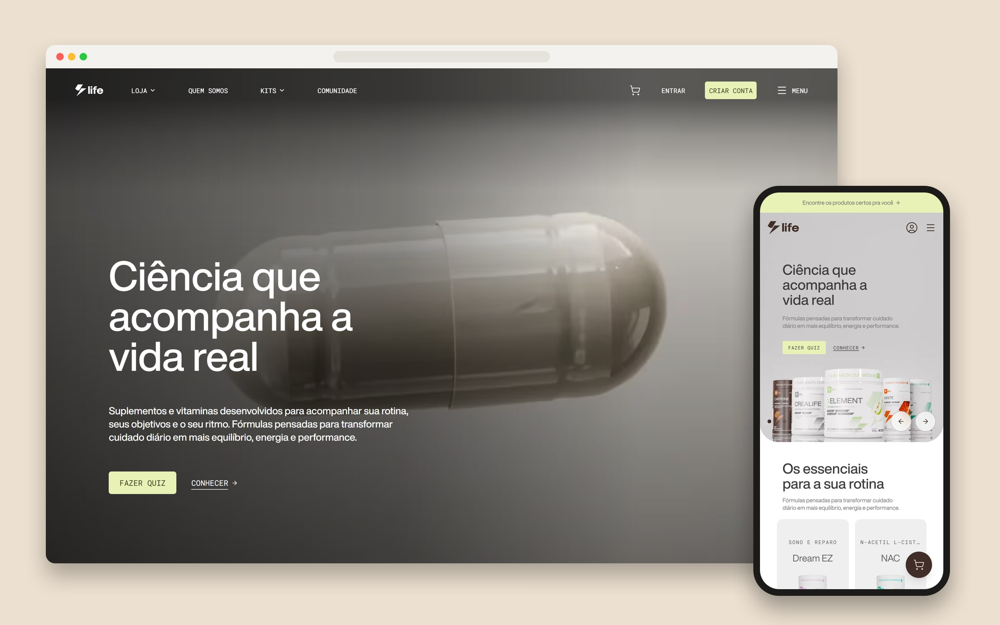
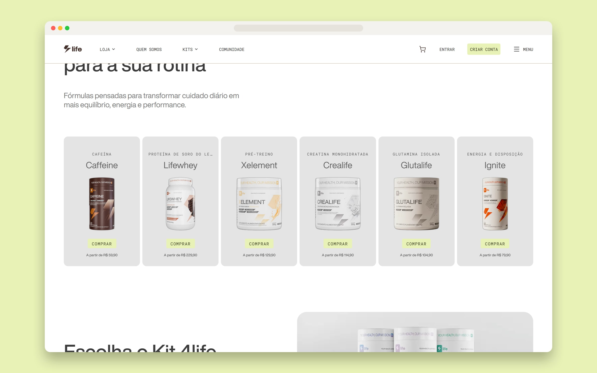
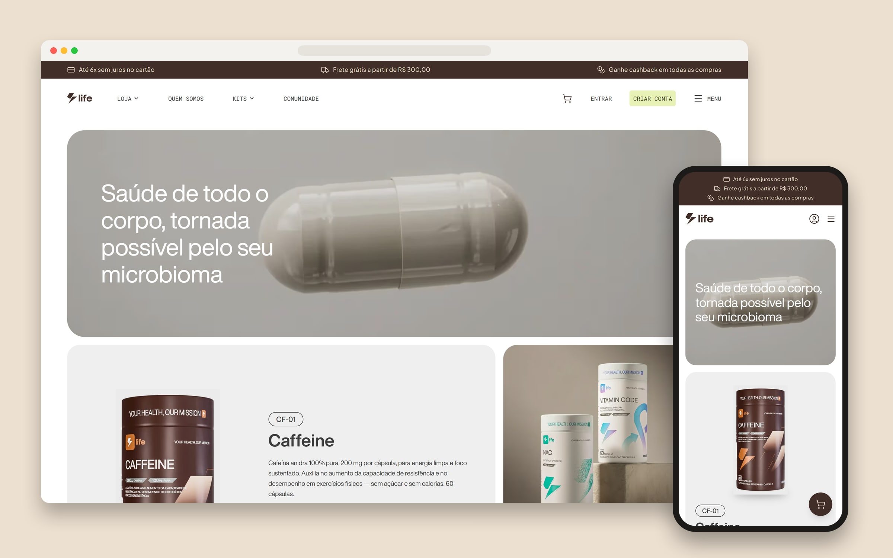
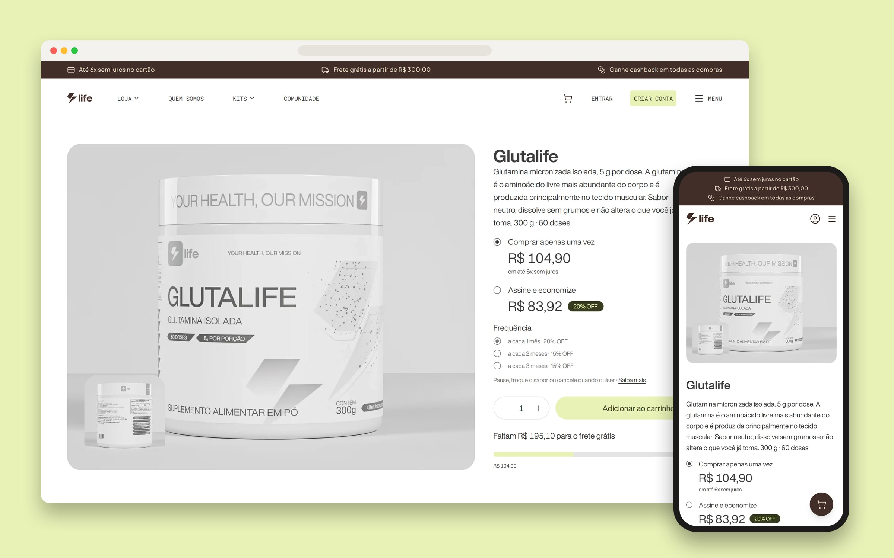
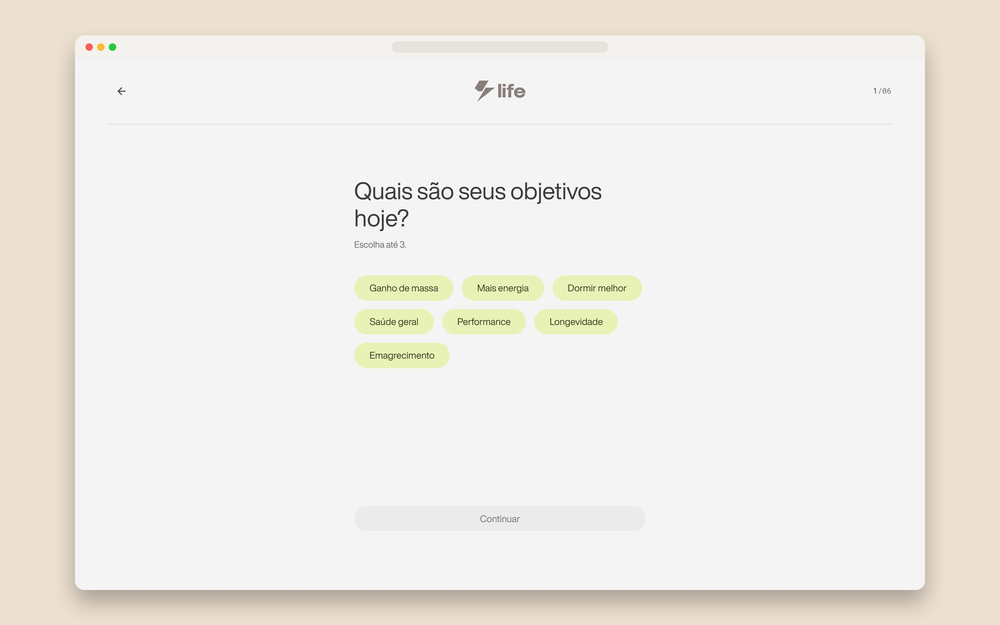
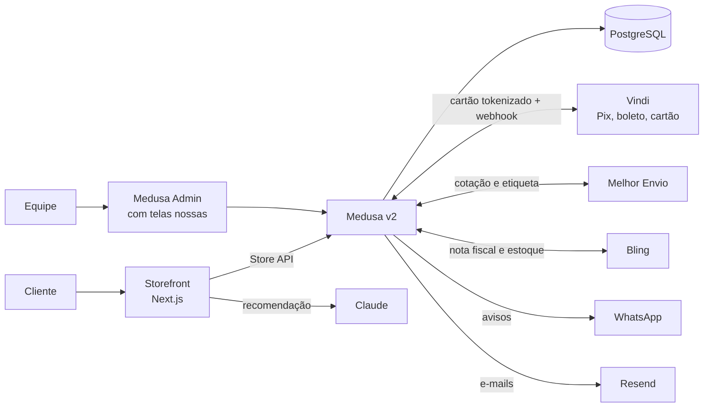

# 4Life Nutrition: e-commerce com código próprio

A 4Life Nutrition é uma marca brasileira de suplementos. Ela vendia pela Nuvemshop e queria uma loja com a cara dela, rápida e sem as amarras de um tema pronto. A loja nova está no ar em [4lifenutrition.com.br](https://4lifenutrition.com.br) desde agosto de 2026 e cuida do pedido inteiro: cobra, emite a nota fiscal, compra a etiqueta e avisa o cliente, sem ninguém copiar dado de um sistema para outro.

> Repositório vitrine, publicado com autorização do cliente. O código é da 4Life e fica num repositório privado.

Entrei no projeto em julho de 2026, numa equipe de dois devs e um colaborador. Fui eu que fiz boa parte do que o cliente vê (home, loja, páginas de produto, carrinho, quiz) e também a assinatura recorrente, o programa de creators e a medição de vendas.

[▶ Vídeo da home](https://youtu.be/bUSzSsntpF4)

| Vitrine da home | Loja |
|---|---|
|  |  |

| Página de produto | Quiz de recomendação |
|---|---|
|  |  |

## Números

| | |
|---|---|
| Commits | ~1.100 desde abril de 2026 |
| Decisões registradas (ADRs) | 85 |
| Specs escritas antes do código | 58 |
| Páginas de produto desenhadas no Figma | 13 de 13 |
| Workflows de CI | 6 |

## Arquitetura

O storefront é Next.js com App Router e Tailwind. O backend é Medusa v2 sobre PostgreSQL, com 15 módulos escritos por nós: pagamento, frete, nota fiscal, assinatura, creators, blog, mídia, consentimento e outros. Tudo roda numa VPS com Docker e Traefik. O GitHub Actions builda a imagem e a VPS puxa pelo digest, então o que está no ar é exatamente o que passou no CI.

## Do clique à caixa no correio

O pagamento só conta quando o webhook da Vindi confirma. O navegador do cliente nunca decide isso. Com o pagamento confirmado, a loja pede a nota ao Bling e espera o SEFAZ autorizar. Só depois compra a etiqueta no Melhor Envio. Se a nota trava, a etiqueta não sai, a equipe recebe um aviso no WhatsApp e o pedido pode ser retomado por uma rota do painel.

O cartão é tokenizado no navegador e o número nunca passa pelo nosso servidor. Isso tirou a loja do PCI SAQ-D. O limite de 6 parcelas é imposto no backend, porque a Vindi aceita 24x sem reclamar.

## Decisões que seguram o sistema

Cada campo tem um dono só. O Bling manda no catálogo fiscal e no estoque, e a loja manda no pedido e na conta a receber. O estoque desce do Bling por webhook, um job confere tudo uma vez por dia, e o Medusa só reserva a unidade enquanto a pessoa compra.

Kit é caixa, não mercadoria. Ele não tem estoque próprio: a disponibilidade é o menor saldo entre os potes que vão dentro. Na nota, o kit sai como os produtos de verdade, com o valor rateado ao centavo.

O cliente vê os quatro serviços de frete (PAC, SEDEX e dois da Jadlog) com preço e prazo, numa chamada só. O frete grátis acima de R$ 300 é uma regra no banco. Para mudar o valor, basta editar o dado, sem deploy.

No quiz, quem decide é uma regra legível, não a IA. A regra exclui pelo rótulo: menores de idade em todos os produtos, gestantes em quase todos. A IA só escolhe entre os candidatos liberados e explica usando as frases já aprovadas das páginas de produto. A resposta passa por uma lista de termos proibidos para suplemento. Sem chave de API, o quiz roda só com a regra e nunca mostra tela de erro.

O painel tem cargos que negam por padrão. Quem entra sem cargo não acessa nada, e a gestora de creators só enxerga a aba dela.

O consentimento de marketing vai para um log no nosso banco onde só se acrescenta linha: quem aceitou, quando, por qual canal, com qual texto na tela e em qual versão da política. O servidor não aceita esse texto vindo do navegador. Para revogar, a pessoa abre uma página e clica num botão, porque scanner de e-mail abre link sozinho e uma revogação feita por robô não prova nada.

Se a API cai, a loja continua de pé. O catálogo vem do cache e a página de produto responde 200 com o backend fora.

## Como o trabalho anda

O projeto segue spec antes de código. Feature relevante começa com uma spec aprovada, e toda decisão vira um ADR que ninguém reescreve: para mudar de ideia, escreve-se outro que substitui o anterior. Tarefa só fecha com evidência (build, rota respondendo, fluxo testado de ponta a ponta). Cada integração tem autoteste no `npm run check`, e as features que mexem com dinheiro ou dado pessoal passam por revisão adversarial antes do merge.

O front segue os frames do Figma no desktop e no celular. Cada entrega foi comparada com o frame, com nota de 9,2 a 9,9 em 10. As animações usam IntersectionObserver e CSS, sem GSAP, respeitam `prefers-reduced-motion` e não pioraram CLS nem LCP.

## O que aprendi pagando caro

A API do Bling aceita payload no formato errado, responde 204 e joga o bloco fora. Hoje toda escrita em sistema externo é lida de volta, porque 2xx não prova nada.

Um endpoint de notas ignorava o filtro e devolvia a conta inteira com 200. Foi assim que um pedido se vinculou à nota de outro. Agora o código confere se o filtro filtrou.

Tirar o `/br` da URL com middleware criou um laço de 50 redirects, porque no Next.js o rewrite de middleware roda de novo sobre o destino. A solução foi `rewrites().afterFiles`.

A loja já rodou sob o domínio do fornecedor, por cortesia, e desfazer isso custou uma migração inteira. Desde então, domínio, conta e chave ficam no nome do cliente desde o primeiro dia.

## Stack

Next.js (App Router) · React · TypeScript · Tailwind CSS · Medusa v2 · PostgreSQL · Docker · Traefik · GitHub Actions · Vindi · Melhor Envio · Bling · Evolution API · Resend · Claude

Veja também a [plataforma de creators da 4Life](https://github.com/Dowgg18/4life-creators-showcase).

---

Douglas Domingos · [github.com/Dowgg18](https://github.com/Dowgg18)
